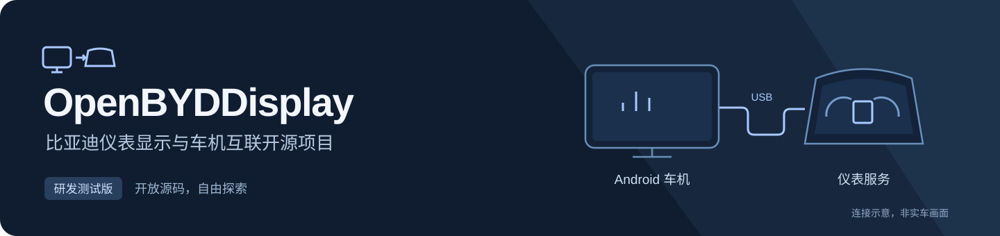

**简体中文** | [English](README.en.md)

# OpenBYDDisplay



<p align="center">
  <a href="https://github.com/wayyoungboy/open-byd-display/releases"><strong>下载测试版</strong></a> ·
  <a href="README.en.md">English</a> ·
  <a href="#开始使用">开始使用</a> ·
  <a href="#文档导航">开发文档</a> ·
  <a href="https://github.com/wayyoungboy/open-byd-display/issues">反馈问题</a> ·
  <a href="https://afdian.com/a/wayyoung">爱发电赞助</a>
</p>

[](https://github.com/wayyoungboy/open-byd-display/actions/workflows/ci.yml)
[](LICENSE)
[](app/build.gradle.kts)

**比亚迪仪表显示与车机互联开源项目。** 从车机客户端、连接协议到自研仪表服务，逐步构建可研究、可验证的开放实现。无需登录、VIP或商业许可证。

> **本项目为测试版本，由个人出于兴趣爱好开发。使用本软件即表示你知悉并自愿承担测试风险。在法律允许的最大范围内，本软件按现状提供，不作任何保证；项目作者、贡献者及相关个人或组织不对可能存在的问题及由此产生的损失承担责任。**

## 当前能做什么

当前为**更新链路研发阶段**。Android客户端与电脑实验服务已实现下列流程，**暂不包含可刷QNX仪表固件，新App尚未完成实车投屏出画验收**。

| 能力 | 已实现内容 |
| --- | --- |
| 更新包预检 | ZIP结构、CRC、SV压缩体MD5；FUP2头、路径和载荷摘要 |
| 上传与安装 | 流式上传、独立手动安装、任务查询、停止传输与清理 |
| 异常恢复 | 持久化任务；结果不明时保留记录，不自动重复安装 |
| 开机自启 | 用户开启后尝试打开App；系统限制与权限状态可见 |
| ADB辅助配置 | 只读权限/IPv4诊断；显式配置后台打开权限 |
| 自研服务实验 | 回环TCP服务、Ed25519验签、目标绑定与实验版本切换 |
| 原生视频核心 | C99 BVL1/LHF2回环接收、帧校验及真实H.264解码实验 |

仪表端投屏接收、QNX原生更新后端及整车恢复流程仍在研发。`instrument/` 只监听电脑回环地址，只操作实验目录，不运行包内`install.sh`、写车辆分区或修改启动记录。开机自启不会恢复上传、提交安装或自动投屏。

更新包签名、摘要、车型与硬件校验继续保留。第三方固件自己的授权与信任公钥不由本项目解除；自有签名包仅适用于信任对应自有公钥的服务。MD5用于完整性检查，不作为真实性凭证。

## 车型研发进度

| 目标 | 进度 | 待确认事项 |
| --- | --- | --- |
| 21款宋 PLUS DM-i | 已建独立目标配置 | 仪表硬件、QNX原生编译与实车刷写 |
| 21款唐 PLUS DM-i | 已按用户名称建独立配置 | 准确车型、仪表型号及分别实车验证 |

两个目标分别适配，固件文件名、版本号或共享OS不能作为互刷依据。

## 开始使用

1. 从 [Releases](https://github.com/wayyoungboy/open-byd-display/releases) 下载标明测试状态的APK，查看对应版本说明。包名为`org.openbyddisplay`，可与小灰灰独立安装。
2. 在车辆静止、供电稳定时连接车机，按 [ADB与自启说明](docs/adb-and-startup.md) 读取配置；需要自启时再开启对应权限和开关。
3. 连接匹配的自研实验服务，选择来源明确的更新包。先检查、再上传、最后手动确认安装；任务结果不明时先查询。

现阶段通过GitHub下载并选择本地文件，不执行无人确认的固件OTA。电脑实验包不可刷入现成仪表；旧App请保留，不要为解决签名冲突卸载或清空数据。

## 文档导航

| 你想做什么 | 入口 |
| --- | --- |
| 配置ADB、开机自启 | [ADB与自启](docs/adb-and-startup.md) |
| 运行电脑实验服务、制作自签名包 | [仪表端实验](docs/instrument-lab.md) |
| 了解自研仪表固件与原生视频进度 | [固件实现](docs/instrument-native.md) / [原生核心](instrument/native/README.md) |
| 研究上传、查询及安装协议 | [更新协议](docs/update-protocol.md) |
| 了解签名、构建与版本分发 | [GitHub开发与分发](docs/github-distribution.md) |
| 查看构建或提交适配问题 | [Actions](https://github.com/wayyoungboy/open-byd-display/actions) / [Issues](https://github.com/wayyoungboy/open-byd-display/issues) |

## 本地开发

需要JDK17、Android SDK34/build-tools34.0.0、Python3.12。配置自己的`local.properties`和Python虚拟环境后，在仓库根目录运行：

```sh
python3 -m pip install -r instrument/requirements.txt
python3 -m unittest discover -s tools/tests -v
PYTHONPATH=instrument python3 -m unittest discover -s instrument/tests -v
./gradlew :app:testDebugUnitTest :app:lintDebug :app:assembleDebug
```

源码、评审、反馈及分发均通过GitHub。改动使用分支和PR，CI提供开发APK，版本标签触发使用稳定独立签名的Release构建。私钥不入Git；完整规则见[分发说明](docs/github-distribution.md)。

## 支持与贡献

欢迎提交可复现的问题、协议研究和有权公开的代码。反馈请写明车型、仪表硬件与版本、车机系统、App版本、操作步骤和错误信息；发布日志前移除车辆标识、账号及密钥。请勿上传第三方APK、固件、反编译代码或商业许可证。

如果这个项目对你有帮助，可以通过[爱发电](https://afdian.com/a/wayyoung)支持个人兴趣开发。**赞助完全自愿，不影响功能和更新下载。**

## 致谢

感谢分享问题、适配结果以及维护Kotlin、AndroidX、Gradle和`cryptography`的贡献者。

## 独立性与许可

本项目与比亚迪、德赛及其他厂商、商业投屏产品不存在隶属、合作、授权、认证或背书关系；名称仅用于说明研究对象，不授予商标使用权。本仓库只发布自主代码与有权再分发的依赖。

修改车机和仪表可能导致不可启动、显示异常、原车功能受影响、数据或财产损失，并可能影响质保或合规状态。支持与适配结论以明确的版本和实际证据为限；“可构建”“收到ACK”“已暂存”不代表车辆可安全刷写或实际出画。

本项目采用 [MIT License](LICENSE)，保留原作者及贡献者版权声明，见 [NOTICE](NOTICE)。
